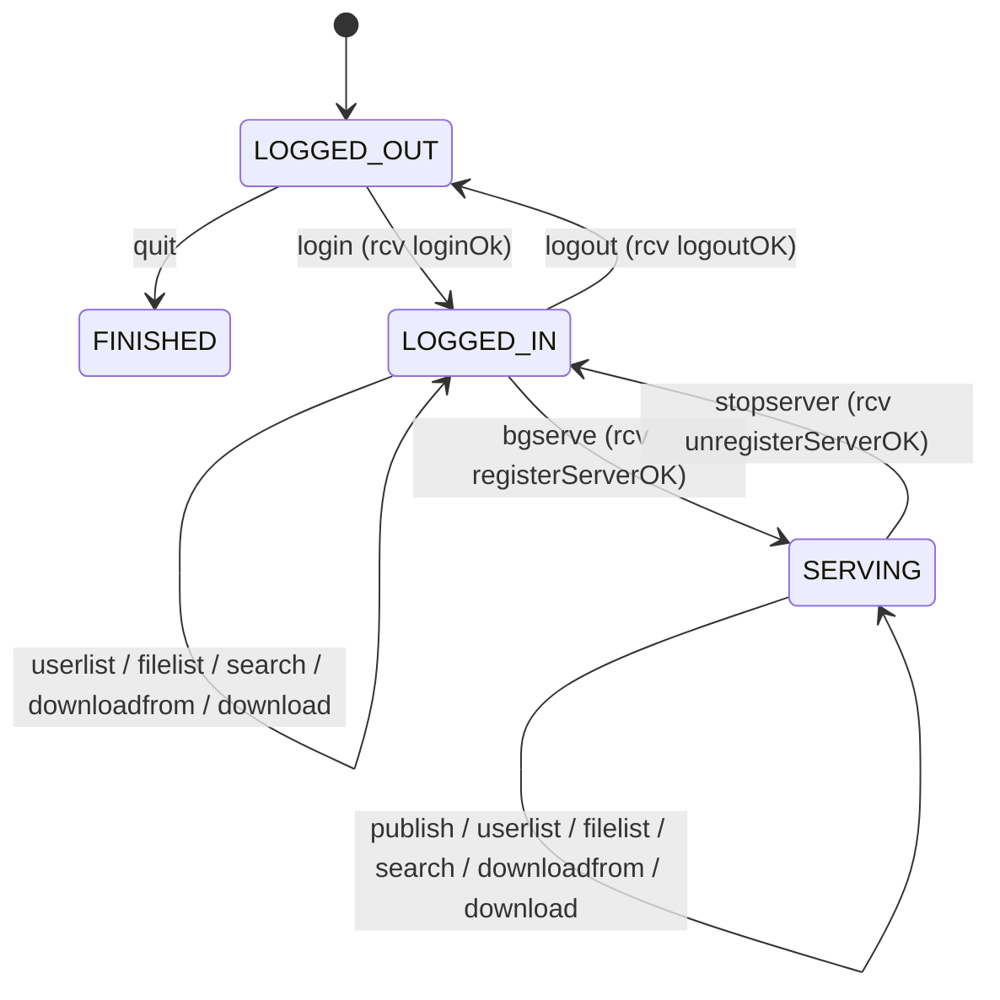
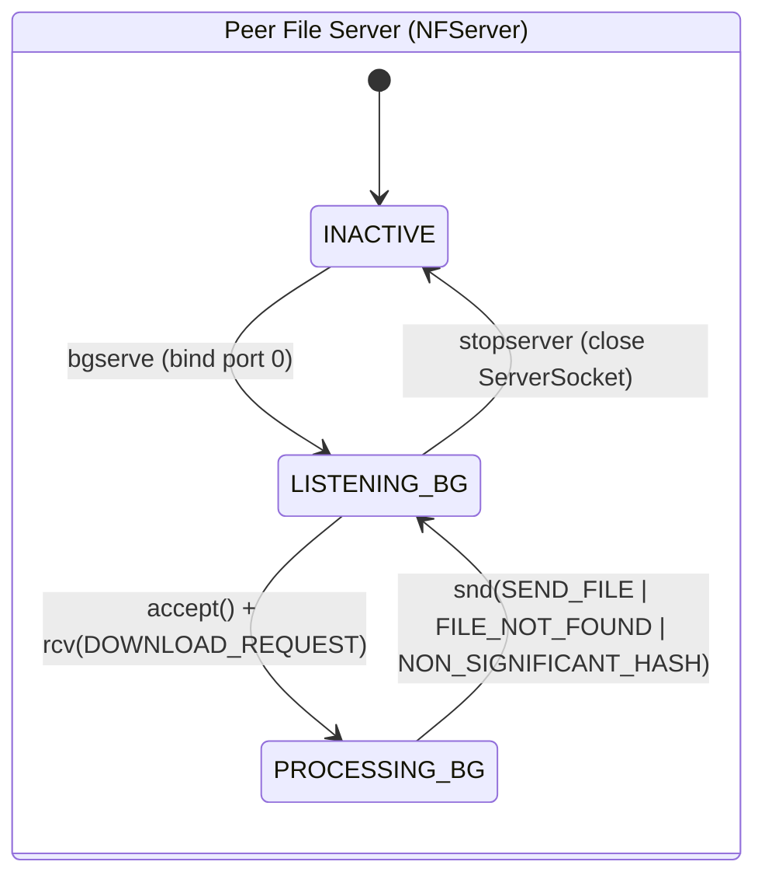

# System Architecture, State Automata & Concurrency Model

NanoFiles implements a **hybrid Peer-to-Peer (P2P)** network architecture separating **control/discovery traffic** (centralized over UDP) from **bulk data transfer** (decentralized peer-to-peer over TCP).

---

## 1. Architectural Topology

```text
                       ┌──────────────────────────────────────┐
                       │      Central Directory Server        │
                       │    NFDirectoryServer (UDP : 6868)    │
                       └──────────▲────────────────▲──────────┘
                                  │                │
         UDP Control Protocol     │                │     UDP Control Protocol
     (login, registerServer,      │                │   (login, filelist, search,
      publish, unregisterServer)  │                │    getServerAddress)
                                  │                │
                       ┌──────────┴────────┐      ┌┴──────────────────┐
                       │   Peer Node A     │      │   Peer Node B     │
                       │ (Uploader/Server) │      │ (Downloader/Peer) │
                       │                   │      │                   │
                       │  NFServer (TCP)   │◄─────┤   NFConnector     │
                       │  Ephemeral Port   │ TCP  │   (TCP Client)    │
                       └───────────────────┘      └───────────────────┘
```

---

## 2. Directory Server In-Memory Data Structures

`NFDirectoryServer` maintains six synchronized in-memory hash tables to track the network topology in $O(1)$ average time:

| Field | Type | Description |
| :--- | :--- | :--- |
| `nicks` | `HashMap<String, Integer>` | Maps active `nickname` $\to$ `sessionKey`. |
| `sessionKeys` | `HashMap<Integer, String>` | Inverse map of `sessionKey` $\to$ `nickname` (randomly generated in $[0, 1000)$). |
| `servingFiles` | `HashMap<Integer, Boolean>` | Indicates whether the peer identified by `sessionKey` has an active file server registered. |
| `serverAddresses` | `HashMap<Integer, InetSocketAddress>` | Stores the `IP:port` TCP endpoint where each active file server listens. |
| `publishedFiles` | `HashMap<Integer, LinkedList<FileInfo>>` | Stores the list of files published by a given `sessionKey`. |
| `hashes` | `HashMap<String, LinkedList<String>>` | Inverted index mapping each 40-char SHA-1 `fileHash` $\to$ list of `nickname`s currently serving it. |

When a peer executes `stopserver` (`unregisterServer`), the directory atomically removes its `serverAddresses` entry, sets `servingFiles` to `false`, removes its `nickname` from every list in `hashes` corresponding to its `publishedFiles` (pruning the hash key entirely if the list becomes empty), and clears its `publishedFiles` entry.

---

## 3. Protocol Finite State Automata (FSM)

### 3.1. Directory Client Automaton (`NFController`)

`NFController` enforces command validity according to three primary states:
- **`LOGGED_OUT` (`0`)**: Initial state before authentication. Only local commands (`myfiles`, `help`, `sleep`) and `login` / `quit` are permitted.
- **`LOGGED_IN` (`3`)**: Authenticated with a valid `sessionKey`. Allows directory queries (`userlist`, `filelist`, `search`), file downloads (`downloadfrom`, `download`), starting a server (`bgserve`, `fgserve`), and `logout`. Disallows `quit` until logged out.
- **`SERVING` (`10`)**: Running a background TCP file server registered with the directory. Unlocks `publish` and `stopserver`. Disallows `logout` and `quit` until the server is stopped via `stopserver`.



### 3.2. Directory Server Automaton (`NFDirectoryServer`)

The directory server operates a single-threaded event loop over a bound `DatagramSocket` (port `6868`), transitioning from `LISTENING` to request-specific processing states (`PROCESSING_LOGIN`, `PROCESSING_USERLIST`, `PROCESSING_REGISTERSERVER`, `PROCESSING_PUBLISH`, `PROCESSING_FILELIST`, `PROCESSING_SEARCH`, `PROCESSING_GETSERVERADDRESS`, `PROCESSING_UNREGISTERSERVER`, `PROCESSING_LOGOUT`) and immediately returning to `LISTENING` after dispatching the UDP response datagram.

### 3.3. P2P File Server & Client Automata



---

## 4. Concurrency & Ephemeral Port Allocation

1. **Ephemeral Port Binding (`NFServer`)**:
   `NFServer` binds its `ServerSocket` to `new InetSocketAddress(0)`, delegating port selection to the OS kernel. The assigned port is retrieved via `serverSocket.getLocalPort()` and advertised to the directory during `registerServer`. This allows multiple peers to run concurrently on the same host (`127.0.0.1`) without port conflicts.
2. **Multithreaded Request Servicing (`NFServerThread`)**:
   The background acceptor thread (`Thread(NFServer)`) blocks on `serverSocket.accept()`. For every incoming peer connection, it spawns an independent `NFServerThread` that executes `NFServerComm.serveFilesToClient(socket)`, enabling parallel file transfers to multiple downloading peers while keeping the interactive `NFShell` responsive.
3. **Graceful Server Termination**:
   `NFServer.stopBackgroundServer()` is `synchronized`, sets `stopServer = true`, and closes `serverSocket` to immediately unblock the acceptor thread from `serverSocket.accept()`.
